# Cine pe cine așteaptă

> Generat automat de `dag/build_dag.py` din `dag/tasks.yaml`. Nu edita de mână:
> schimbă planul printr-un PR la `dag/tasks.yaml`. Istoricul: `git log -p DAG.md`.

**Gata:** 19/40 · **În lucru:** 4 · **Poate începe:** 2 · **Așteaptă:** 15 · **Blocat:** 0

```mermaid
flowchart LR
  subgraph t_owner_A["A"]
    t_A1["A1 · Serverul WebSocket + HTTP după specs/06, cu agent fals (AGENT_FAKE=1) și jurnalul rulărilor<br/>✅ gata"]
    t_A2["A2 · Bucla agentului cu OpenRouter cap-coadă pe o pagină reală - get_page_snapshot, apply_css, verificare, say, finish (+ agentul fals adaptat)<br/>✅ gata"]
    t_A3["A3 · Uneltele etapei 2 - apply_ops, point_at, propose_changes, ask_user, wait_for_user_click + promptul care cere verificare după fiecare schimbare<br/>🔨 în lucru"]
    t_A6["A6 · Profilul și rețeta site-ului în contextul agentului + update_profile; o cerere repetată devine preferință generală<br/>⏳ așteaptă"]
    t_A4["A4 · Tratarea eșecurilor - element negăsit, CSS sau HTML respins la validare, audit picat, pagină schimbată între pași, TIMEOUT, maxSteps, erori OpenRouter<br/>⏳ așteaptă"]
    t_A5["A5 · Rețetele pe server - GET/PUT /api/recipes/:userId și /:host, în locul /api/config (stocare data/recipes)<br/>⏳ așteaptă"]
  end
  subgraph t_owner_B["B"]
    t_B1["B1 · Store-ul UIConfig (Zustand) cu poarta de limite, undo/istoric, temă → variabile CSS, LayoutRenderer + 3 șabloane<br/>✅ gata"]
    t_B6["B6 · Motorul de rețete v2 - DomOp (remove, move, wrap, setText), undo pe revizii, reaplicare când pagina își schimbă singură conținutul<br/>🔨 în lucru"]
    t_B3["B3 · Elemente generate la cerere - HTML scris de agent și curățat (insertHtml) sau componente din catalog (inject), legate de elemente reale (bind, specs/03)<br/>⏳ așteaptă"]
    t_B4["B4 · Refacerea liberă a unui site - „fă-l să arate ca site-ul X” și pagina simplă făcută din elementele care contează, pe perechile de site-uri din demo<br/>⏳ așteaptă"]
  end
  subgraph t_owner_C["C"]
    t_C1["C1 · Motorul de audit - min-font, contrast, target-size, overlap, clipped, offscreen, line-height + scor (specs/07)<br/>✅ gata"]
    t_C5["C5 · Validarea a ce scrie agentul - CSS (fără url, @import, selectori spre interfața noastră) și HTML (fără script, iframe, atribute on*), funcții pure cu teste<br/>✅ gata"]
    t_C2["C2 · Auditul pe pagina unui site, rulat după fiecare schimbare a agentului + reparațiile ca CSS; unealta audit_ui<br/>✅ gata"]
    t_C3["C3 · Testul inițial ca pagină a extensiei - lizibilitate, atingere, site-uri cunoscute, ce te deranjează, „Omite” pe fiecare ecran (specs/10)<br/>🔨 în lucru · încă așteaptă M2"]
    t_C4["C4 · Preferințele de bază fără AI - din profil, pe orice site - font minim, contrast, ținte mari, aplicate peste CSS-ul agentului<br/>✅ gata"]
  end
  subgraph t_owner_D["D"]
    t_D1["D1 · Scheletul monorepo (npm workspaces, apps/web Vite+React+TS, apps/server Express+ws+tsx, npm run dev)<br/>✅ gata"]
    t_D4["D4 · Panoul de control - pași live, scor audit, Oprește, Păstrez/Anulez, istoric, reluare pas cu pas<br/>✅ gata"]
    t_D7["D7 · Contractele etapei 1 - SiteRecipe cu CSS, snapshot-ul paginii, uneltele get_page_snapshot/apply_css/say/finish, mesajele + specs 02, 04, 05, 06 rescrise<br/>✅ gata"]
    t_M0["M0 · PUNCT DE CONTROL 0 - extensia se vede pe două site-uri reale și mesajul de probă face drumul dus-întors<br/>✅ gata"]
    t_D3["D3 · Chatul în extensie - câmp de text și bula de răspuns peste orice site, legate de server prin service worker<br/>✅ gata"]
    t_D8["D8 · Contractele etapelor 2-4, ca adăugări - DomOp (remove, move, wrap, setText, insertHtml, bind, inject), point_at, propose_changes, audit, profilul extins, conturi + specs 03, 07-12<br/>✅ gata"]
    t_M1["M1 · PUNCT DE CONTROL 1 - „ascunde X” pe site-ul de test și pe un site real, dispare și rămâne dispărut după reîncărcare, „Revino la original” îl aduce înapoi<br/>✅ gata"]
    t_D2["D2 · Mascota - animal animat din asset-uri cu licență liberă, se plimbă prin pagină și arată elementul (specs/11)<br/>🟢 poate începe"]
    t_D9["D9 · Panoul de control în extensie - pași live, Oprește, previzualizare cu Păstrez/Anulez, „Revino la original” (refolosește D4)<br/>🟢 poate începe"]
    t_M2["M2 · PUNCT DE CONTROL 2 - „mută X sus” merge și rămâne, mascota merge la element, pașii se văd în panou, Anulez readuce pagina<br/>⏳ așteaptă"]
    t_D10["D10 · Vocea - cererea vorbită (Web Speech ro-RO) din bula mascotei<br/>⏳ așteaptă"]
    t_M3["M3 · PUNCT DE CONTROL 3 - instalare proaspătă → test → profil; un site nou are fontul minim fără AI; o scurtătură generată merge; cererea vorbită merge<br/>⏳ așteaptă"]
    t_M4["M4 · PUNCT DE CONTROL 4 - „fă-l să arate ca X” pe perechea din demo, propunerea automată după ratări, preferințele pe alt profil de browser după login<br/>⏳ așteaptă"]
    t_D5["D5 · Integrare cap-coadă - scenariul din specs/12-demo.md merge fără intervenție<br/>⏳ așteaptă"]
    t_D6["D6 · Pitch de 5 minute, descrierea de o pagină, screenshot-uri, README final, trimiterea pe Slack<br/>⏳ așteaptă"]
  end
  subgraph t_owner_E["E"]
    t_E1["E1 · Profilul (memoria tip ICP) - schema, stocare JSON, API, rezumatul pentru prompt (specs/08)<br/>✅ gata"]
    t_E5["E5 · Scheletul extensiei Chrome (MV3) - manifest, content script cu rădăcină shadow DOM, service worker cu WebSocket la server, popup, stocare locală<br/>✅ gata"]
    t_B2["B2 · Registrul paginii - snapshot rezumat al unui site oarecare (zone, titluri, elemente vizibile), id-uri și selectori stabili + executorul uneltelor în pagină<br/>✅ gata"]
    t_B5["B5 · Motorul de rețete v1 - aplică CSS-ul validat, îl salvează pe site în stocarea locală, îl reaplică fără AI la încărcare, „Revino la original”<br/>✅ gata"]
    t_E7["E7 · Site-ul de test - o pagină aglomerată intenționat (meniuri, bannere, un „plătește factura” greu de găsit), servită local, cu date de test<br/>✅ gata"]
    t_E2["E2 · Colectarea semnalelor în content script - misclick, zoom, back_loop, dwell, feature_use, help_request (specs/09)<br/>🔨 în lucru"]
    t_E8["E8 · Profilul extins - site-uri familiare și preferințe generale care trec de la un site la altul, ținut local și pe server (specs/08)<br/>⏳ așteaptă"]
    t_E3["E3 · Adaptarea automată - reguli pe semnale, încrederea (autoApplyLowRisk) și preferințele generale propuse singure pe site-uri noi<br/>⏳ așteaptă"]
    t_E6["E6 · Cont opțional și sincronizare - merge fără login (local), cu login preferințele trec pe alt dispozitiv<br/>⏳ așteaptă"]
    t_E4["E4 · Butonul „Resetează demo-ul”, măsurătorile pentru pitch, videoul de rezervă<br/>⏳ așteaptă"]
  end
  t_D1 --> t_A1
  t_D1 --> t_B1
  t_D1 --> t_C1
  t_A1 --> t_D4
  t_B1 --> t_D4
  t_D1 --> t_E1
  t_D1 --> t_D7
  t_D1 --> t_E5
  t_D7 --> t_M0
  t_E5 --> t_M0
  t_B1 --> t_B2
  t_M0 --> t_B2
  t_M0 --> t_C5
  t_M0 --> t_B5
  t_C5 --> t_B5
  t_A1 --> t_A2
  t_M0 --> t_A2
  t_A1 --> t_D3
  t_M0 --> t_D3
  t_M0 --> t_E7
  t_D7 --> t_D8
  t_B2 --> t_M1
  t_B5 --> t_M1
  t_A2 --> t_M1
  t_D3 --> t_M1
  t_E7 --> t_M1
  t_M1 --> t_B6
  t_D8 --> t_B6
  t_A2 --> t_A3
  t_M1 --> t_A3
  t_D8 --> t_A3
  t_M1 --> t_D2
  t_B2 --> t_D2
  t_M1 --> t_D9
  t_C1 --> t_C2
  t_M1 --> t_C2
  t_D8 --> t_C2
  t_M1 --> t_E2
  t_B2 --> t_E2
  t_B6 --> t_M2
  t_A3 --> t_M2
  t_D2 --> t_M2
  t_D9 --> t_M2
  t_C2 --> t_M2
  t_E2 --> t_M2
  t_E1 --> t_C3
  t_M2 --> t_C3
  t_E1 --> t_E8
  t_M2 --> t_E8
  t_A3 --> t_A6
  t_E8 --> t_A6
  t_C2 --> t_C4
  t_C3 --> t_C4
  t_B6 --> t_C4
  t_B6 --> t_B3
  t_C5 --> t_B3
  t_M2 --> t_B3
  t_D3 --> t_D10
  t_M2 --> t_D10
  t_C3 --> t_M3
  t_E8 --> t_M3
  t_A6 --> t_M3
  t_C4 --> t_M3
  t_B3 --> t_M3
  t_D10 --> t_M3
  t_B3 --> t_B4
  t_M3 --> t_B4
  t_A6 --> t_A4
  t_M3 --> t_A4
  t_M3 --> t_A5
  t_E2 --> t_E3
  t_A6 --> t_E3
  t_M3 --> t_E3
  t_A5 --> t_E6
  t_E8 --> t_E6
  t_M3 --> t_E6
  t_B4 --> t_M4
  t_A4 --> t_M4
  t_E3 --> t_M4
  t_E6 --> t_M4
  t_M4 --> t_D5
  t_D5 --> t_E4
  t_D5 --> t_D6
  classDef done fill:#d3f5dc,stroke:#1a7f37,color:#0b3d1a,stroke-width:2px
  classDef progress fill:#d6e8ff,stroke:#0969da,color:#0a2d5c,stroke-width:2px
  classDef ready fill:#fff4c2,stroke:#9a6700,color:#4d3300,stroke-width:2px
  classDef wait fill:#eaeef2,stroke:#6e7781,color:#24292f,stroke-width:2px
  classDef blocked fill:#ffd8d3,stroke:#cf222e,color:#5c0b10,stroke-width:2px
  class t_D1,t_A1,t_B1,t_C1,t_D4,t_E1,t_D7,t_E5,t_M0,t_B2,t_C5,t_B5,t_A2,t_D3,t_E7,t_D8,t_M1,t_C2,t_C4 done
  class t_B6,t_A3,t_E2,t_C3 progress
  class t_D2,t_D9 ready
  class t_M2,t_E8,t_A6,t_B3,t_D10,t_M3,t_B4,t_A4,t_A5,t_E3,t_E6,t_M4,t_D5,t_E4,t_D6 wait
```

## Poate începe acum

- **D2** (D) Mascota - animal animat din asset-uri cu licență liberă, se plimbă prin pagină și arată elementul (specs/11) _(Etapa 2 · sâm 00:00. Gata = pe un site real, mascota merge până la elementul cerut de point\_at și rămâne pe el la scroll și resize; licența asset-urilor e notată în repo.)_
- **D9** (D) Panoul de control în extensie - pași live, Oprește, previzualizare cu Păstrez/Anulez, „Revino la original” (refolosește D4) _(Etapa 2 · sâm 00:30. Gata = o rulare se vede pas cu pas peste site; Anulez readuce pagina cum era înainte de rulare.)_

## Blocat

_nimic_

## În lucru

- **B6** (B) Motorul de rețete v2 - DomOp (remove, move, wrap, setText), undo pe revizii, reaplicare când pagina își schimbă singură conținutul: PR #36 deschis _(Etapa 2 · sâm 00:00. Gata = „mută căutarea sus” rezistă la reîncărcare și la navigarea în interiorul site-ului; Anulez scoate doar ultima schimbare.)_
- **A3** (A) Uneltele etapei 2 - apply\_ops, point\_at, propose\_changes, ask\_user, wait\_for\_user\_click + promptul care cere verificare după fiecare schimbare: PR #41 deschis _(Etapa 2 · sâm 00:30. Gata = agentul mută un element, verifică, cere Păstrez/Anulez și arată rezultatul; la o cerere neclară întreabă.)_
- **E2** (E) Colectarea semnalelor în content script - misclick, zoom, back\_loop, dwell, feature\_use, help\_request (specs/09): PR #42 deschis _(Etapa 2 · sâm 00:00. Gata = loturile de semnale de pe un site real ajung pe server și se văd în log. Se folosesc în etapa 4 (E3).)_
- **C3** (C) Testul inițial ca pagină a extensiei - lizibilitate, atingere, site-uri cunoscute, ce te deranjează, „Omite” pe fiecare ecran (specs/10): PR #9 deschis; încă așteaptă M2 _(Etapa 3 · sâm 02:30. Gata = la instalare se deschide testul; răspunsurile (inclusiv familiaritate, AI, clipuri scurte, aglomerație) ajung în profil.)_

## Așteaptă

- **M2** (D) PUNCT DE CONTROL 2 - „mută X sus” merge și rămâne, mascota merge la element, pașii se văd în panou, Anulez readuce pagina: așteaptă B6, A3, D2, D9, E2 _(sâm 01:00. Fără PR: D îl marchează prin comms după ce omul a văzut că merge.)_
- **E8** (E) Profilul extins - site-uri familiare și preferințe generale care trec de la un site la altul, ținut local și pe server (specs/08): așteaptă M2 _(Etapa 3 · sâm 02:00. Gata = profilul rezistă la repornirea browserului fără cont; rezumatul pentru prompt include preferințele generale.)_
- **A6** (A) Profilul și rețeta site-ului în contextul agentului + update\_profile; o cerere repetată devine preferință generală: așteaptă A3, E8 _(Etapa 3 · sâm 03:00. Gata = cine a spus „nu vreau AI” pe un site nu mai trebuie să explice pe următorul; agentul nu reface ce e deja în rețetă.)_
- **B3** (B) Elemente generate la cerere - HTML scris de agent și curățat (insertHtml) sau componente din catalog (inject), legate de elemente reale (bind, specs/03): așteaptă B6, M2 _(Etapa 3 · sâm 03:00. Gata = „vreau o scurtătură spre X” pune un element nou în pagină, apăsarea lui îl declanșează pe cel real, rămâne după reîncărcare; HTML cu script sau on\* e respins.)_
- **D10** (D) Vocea - cererea vorbită (Web Speech ro-RO) din bula mascotei: așteaptă M2 _(Etapa 3 · sâm 02:30. Gata = o cerere vorbită ajunge la agent ca una scrisă; dacă browserul nu are recunoaștere vocală, butonul nu apare.)_
- **M3** (D) PUNCT DE CONTROL 3 - instalare proaspătă → test → profil; un site nou are fontul minim fără AI; o scurtătură generată merge; cererea vorbită merge: așteaptă C3, E8, A6, B3, D10 _(sâm 03:30. Fără PR: D îl marchează prin comms după ce omul a văzut că merge.)_
- **B4** (B) Refacerea liberă a unui site - „fă-l să arate ca site-ul X” și pagina simplă făcută din elementele care contează, pe perechile de site-uri din demo: așteaptă B3, M3 _(Etapa 4 · sâm 06:00. Gata = pe perechea aleasă pentru demo, „fă-l să arate ca X” schimbă așezarea și stilul, pagina rămâne folosibilă și rețeta rezistă la reîncărcare; pe site-ul de test, „vreau doar să plătesc factura” lasă o pagină simplă.)_
- **A4** (A) Tratarea eșecurilor - element negăsit, CSS sau HTML respins la validare, audit picat, pagină schimbată între pași, TIMEOUT, maxSteps, erori OpenRouter: așteaptă A6, M3 _(Etapa 4 · sâm 05:30. Gata = fiecare eroare din specs/05 are un test sau un scenariu manual care arată reacția agentului.)_
- **A5** (A) Rețetele pe server - GET/PUT /api/recipes/:userId și /:host, în locul /api/config (stocare data/recipes): așteaptă M3 _(Etapa 4 · sâm 04:30. Gata = o rețetă salvată pentru un site se citește înapoi; lista site-urilor unui utilizator. O folosește E6.)_
- **E3** (E) Adaptarea automată - reguli pe semnale, încrederea (autoApplyLowRisk) și preferințele generale propuse singure pe site-uri noi: așteaptă E2, A6, M3 _(Etapa 4 · sâm 05:30. Gata = 3 ratări lângă un buton pornesc singure propunerea „butoane mai mari”; pe un site nou, mascota propune singură preferințele generale.)_
- **E6** (E) Cont opțional și sincronizare - merge fără login (local), cu login preferințele trec pe alt dispozitiv: așteaptă A5, E8, M3 _(Etapa 4 · sâm 06:30. Gata = după login pe alt profil de browser apar același profil și aceleași rețete. Parola doar ca hash.)_
- **M4** (D) PUNCT DE CONTROL 4 - „fă-l să arate ca X” pe perechea din demo, propunerea automată după ratări, preferințele pe alt profil de browser după login: așteaptă B4, A4, E3, E6 _(sâm 06:30. Fără PR: D îl marchează prin comms. Ce nu merge la 07:00 se taie din demo; etapele 1-3 rămân.)_
- **D5** (D) Integrare cap-coadă - scenariul din specs/12-demo.md merge fără intervenție: așteaptă M4 _(sâm 09:00 (înghețul). Gata = pașii din demo merg de 3 ori la rând, pe site-urile reale alese și pe site-ul de test.)_
- **E4** (E) Butonul „Resetează demo-ul”, măsurătorile pentru pitch, videoul de rezervă: așteaptă D5 _(sâm 11:00. Cifrele măsurate, nu inventate; videoul înregistrat pe scenariul din specs/12.)_
- **D6** (D) Pitch de 5 minute, descrierea de o pagină, screenshot-uri, README final, trimiterea pe Slack: așteaptă D5 _(sâm 13:30. Se marchează cu \[gata D6\] după trimitere.)_

## Cel mai lung lanț rămas

B6 → M2 → E8 → A6 → M3 → A5 → E6 → M4 → D5 → E4 (10 taskuri)

## Legendă

| Stare | Semn | Culoare |
|---|---|---|
| gata | ✅ | `#1a7f37` |
| în lucru | 🔨 | `#0969da` |
| poate începe | 🟢 | `#9a6700` |
| așteaptă | ⏳ | `#6e7781` |
| blocat | ⛔ | `#cf222e` |
