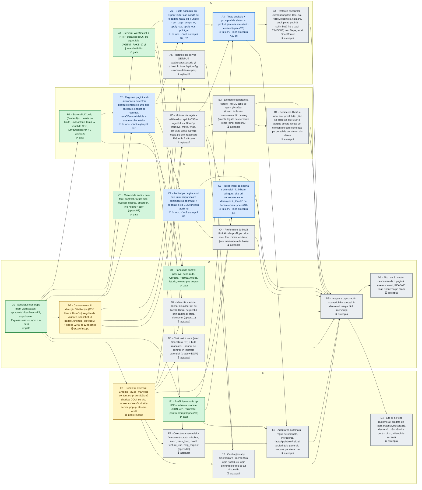

# Cine pe cine așteaptă

> Generat automat de `dag/build_dag.py` din `dag/tasks.yaml`. Nu edita de mână:
> schimbă planul printr-un PR la `dag/tasks.yaml`. Istoricul: `git log -p DAG.md`.

**Gata:** 6/27 · **În lucru:** 5 · **Poate începe:** 2 · **Așteaptă:** 14 · **Blocat:** 0

## Poate începe acum

- **D7** (D) Contractele noii direcții - SiteRecipe (CSS liber + DomOp), regulile de validare, snapshot-ul paginii, uneltele, protocolul + specs 02-06 și 12 rescrise _(vin 19:00. Gata = tipurile din packages/contracts trec check; specs/02-06 descriu rețeta, registrul paginii, uneltele și mesajele; specs/12 are scenariul nou. Blochează aproape tot: primul de făcut.)_
- **E5** (E) Scheletul extensiei Chrome (MV3) - manifest, content script cu rădăcină shadow DOM, service worker cu WebSocket la server, popup, stocare locală _(vin 20:00. Gata = extensia încărcată „unpacked” arată un element al nostru pe orice site, iar un mesaj de probă face drumul pagină → service worker → server și înapoi. Blochează B5, D2, D3, C3, E2: primul de făcut.)_

## Blocat

_nimic_

## În lucru

- **A2** (A) Bucla agentului cu OpenRouter cap-coadă pe o pagină reală, cu 4 unelte - get\_page\_snapshot, apply\_css, apply\_ops, point\_at: branch `a2-bucla` are commit-uri; încă așteaptă D7, B2 _(vin 23:00. Gata = „ascunde X” și „fă bara de sus albastră” pe o pagină: snapshot → apply\_css/apply\_ops → snapshot de verificare, cu pașii în jurnal.)_
- **A3** (A) Toate uneltele + promptul de sistem + profilul și rețeta site-ului în context (specs/05): branch `a3-unelte` are commit-uri; încă așteaptă A2, B5 _(sâm 02:00. Gata = ask\_user, propose\_changes, audit\_ui, generate\_component, wait\_for\_user\_click, say, update\_profile, finish; promptul cere verificare după fiecare schimbare.)_
- **B2** (B) Registrul paginii - id-uri stabile și selectori pentru elementele unui site oarecare, snapshot rezumat, rectOf/ensureVisible + executorul uneltelor: PR #16 deschis; încă așteaptă D7 _(vin 22:00. Gata = pe o pagină reală mare, snapshot-ul are zonele, titlurile și elementele interactive vizibile, sub limita de mărime din D7; același element primește același id după reîncărcare.)_
- **C2** (C) Auditul pe pagina unui site, rulat după fiecare schimbare a agentului + reparațiile ca CSS; unealta audit\_ui: PR #17 deschis; încă așteaptă B2 _(sâm 00:00. Gata = audit\_ui pe o pagină reală întoarce AuditReport într-un timp rezonabil, cu fix-uri aplicabile cu apply\_css; un CSS al agentului care coboară textul sub limită apare în raport.)_
- **C3** (C) Testul inițial ca pagină a extensiei - lizibilitate, atingere, site-uri cunoscute, ce te deranjează, „Omite” pe fiecare ecran (specs/10): PR #9 deschis; încă așteaptă E5 _(sâm 01:00. Gata = la instalare se deschide testul; profilul se salvează local și pe server; întrebările noi (familiaritate, AI, clipuri scurte, aglomerație) ajung în profil.)_

## Așteaptă

- **D2** (D) Mascota - animal animat din asset-uri cu licență liberă, se plimbă prin pagină și arată elementul (specs/11): așteaptă E5, B2 _(vin 23:30. Gata = pe un site real, mascot.pointAt(id) merge până la element și rămâne pe el la scroll/resize; licența asset-urilor e notată în repo.)_
- **D3** (D) Chat text + voce (Web Speech ro-RO) + bula mascotei + panoul de control, în interfața extensiei (shadow DOM): așteaptă E5 _(sâm 00:30. Gata = pe orice site, mesajul scris sau vorbit ajunge la server; agent\_message apare în bulă; pașii, Păstrez/Anulez și „Revino la original” se văd în panou.)_
- **D5** (D) Integrare cap-coadă - scenariul din specs/12-demo.md merge fără intervenție: așteaptă A4, B3, B4, C2, C3, C4, D2, D3, E3, E6 _(sâm 09:00 (înghețul). Gata = pașii din demo merg de 3 ori la rând, pe site-urile reale alese și pe site-ul de test. Ce nu merge la 07:00 din B4/E6 se taie din demo.)_
- **D6** (D) Pitch de 5 minute, descrierea de o pagină, screenshot-uri, README final, trimiterea pe Slack: așteaptă D5 _(sâm 13:30. Se marchează cu \[gata D6\] după trimitere.)_
- **A5** (A) Rețetele pe server - GET/PUT /api/recipes/:userId și /:host, în locul /api/config (stocare data/recipes): așteaptă D7 _(vin 21:00. Gata = o rețetă salvată pentru un site se citește înapoi; lista site-urilor unui utilizator; validată pe tipurile din D7.)_
- **A4** (A) Tratarea eșecurilor - element negăsit, CSS sau HTML respins la validare, audit picat, pagină schimbată între pași, TIMEOUT, maxSteps, erori OpenRouter: așteaptă A3 _(sâm 05:00. Gata = fiecare eroare din specs/05 are un test sau un scenariu manual care arată reacția agentului.)_
- **B5** (B) Motorul de rețete - validează și aplică CSS-ul agentului și DomOp (remove, move, wrap, setText), undo, salvare locală pe site, reaplicare fără AI la încărcare: așteaptă D7, E5 _(vin 23:30. Gata = o rețetă cu CSS + remove + move rezistă la reîncărcare fără apel la server și fără să clipească pagina; se reaplică și când pagina își schimbă singură conținutul; CSS cu url() sau @import e respins; „Revino la original” o golește.)_
- **B3** (B) Elemente generate la cerere - HTML scris de agent și curățat (insertHtml) sau componente din catalog (inject), legate de elemente reale (bind, specs/03): așteaptă B2, B5 _(sâm 02:00. Gata = un element generat apare în pagină, apăsarea lui declanșează elementul real, rămâne după reîncărcare și trece auditul; HTML cu \<script\> sau atribute on\* e respins.)_
- **B4** (B) Refacerea liberă a unui site (nivelul 4) - „fă-l să arate ca site-ul X” și pagina simplă făcută din elementele care contează, pe perechile de site-uri din demo: așteaptă B3 _(sâm 05:00. P1, partea de „wow”. Gata = pe perechea de site-uri aleasă pentru demo, „fă-l să arate ca X” schimbă așezarea și stilul, pagina rămâne folosibilă și rețeta rezistă la reîncărcare; pe site-ul de test, „vreau doar să plătesc factura” lasă o pagină simplă. Dacă nu e stabil la 07:00, se taie din demo.)_
- **C4** (C) Preferințele de bază fără AI - din profil, pe orice site - font minim, contrast, ținte mari (rețeta de bază): așteaptă B5, C2 _(sâm 03:00. Gata = cu profilul „20px, contrast mare”, un site nou are textul de cel puțin 20px de la prima încărcare, fără niciun apel la model; rețeta de bază se aplică ultima, peste CSS-ul agentului.)_
- **E2** (E) Colectarea semnalelor în content script - misclick, zoom, back\_loop, dwell, feature\_use, help\_request (specs/09): așteaptă E5, B2 _(sâm 00:00. Gata = loturile de semnale de pe un site real ajung pe server și se văd în log.)_
- **E6** (E) Cont opțional și sincronizare - merge fără login (local), cu login preferințele trec pe alt dispozitiv: așteaptă E5, B5, A5 _(sâm 03:00. Gata = fără cont, profilul și rețetele rezistă la repornirea browserului; după login pe alt profil de browser, apar aceleași preferințe. Parola doar ca hash.)_
- **E3** (E) Adaptarea automată - reguli pe semnale, încrederea (autoApplyLowRisk) și preferințele generale propuse pe site-uri noi: așteaptă E2, A3 _(sâm 05:00. Gata = 3 ratări lângă un buton pornesc singure propunerea „butoane mai mari”; cine a cerut „fără AI” pe un site primește propunerea și pe următorul.)_
- **E4** (E) Site-ul de test (aglomerat, cu date de test), butonul „Resetează demo-ul”, măsurătorile pentru pitch, videoul de rezervă: așteaptă D5 _(sâm 11:00. Site-ul de test se poate face din prima seară (fără dependențe); videoul după D5.)_

## Cel mai lung lanț rămas

D7 → B2 → A2 → A3 → A4 → D5 → D6 (7 taskuri)

## Legendă

| Stare | Semn | Culoare |
|---|---|---|
| gata | ✅ | `#1a7f37` |
| în lucru | 🔨 | `#0969da` |
| poate începe | 🟢 | `#9a6700` |
| așteaptă | ⏳ | `#6e7781` |
| blocat | ⛔ | `#cf222e` |
