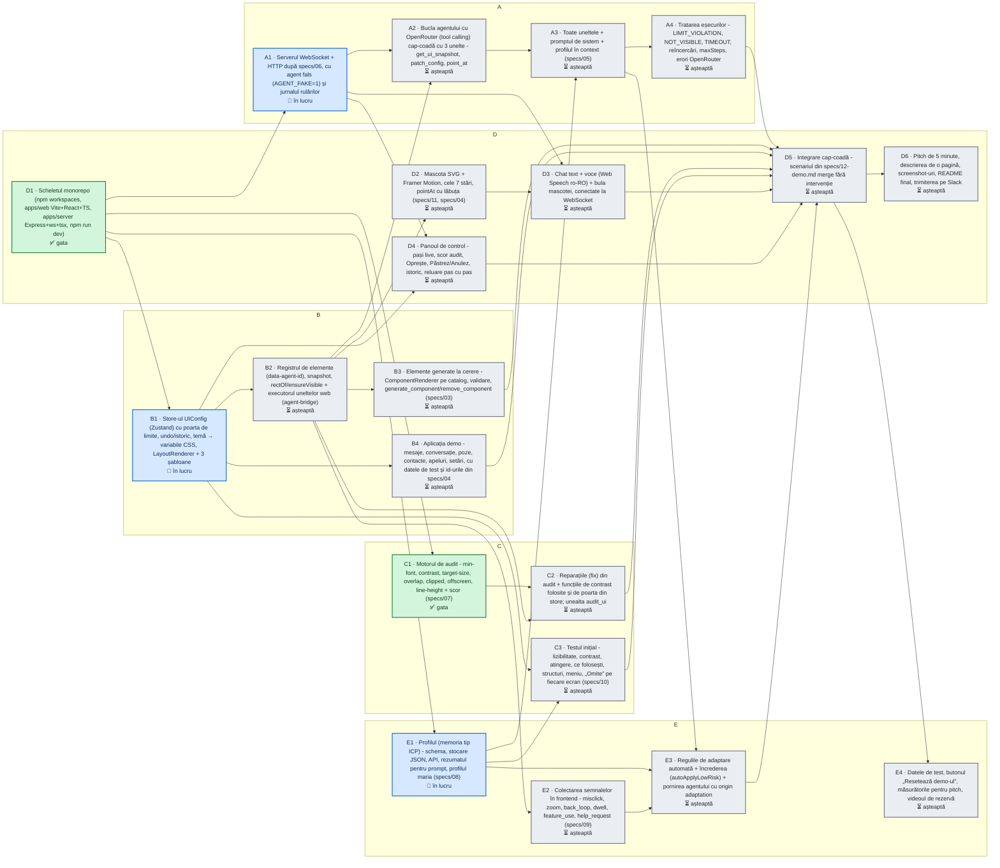

# Cine pe cine așteaptă

> Generat automat de `dag/build_dag.py` din `dag/tasks.yaml`. Nu edita de mână:
> schimbă planul printr-un PR la `dag/tasks.yaml`. Istoricul: `git log -p DAG.md`.

**Gata:** 2/21 · **În lucru:** 3 · **Poate începe:** 0 · **Așteaptă:** 16 · **Blocat:** 0

## Poate începe acum

_nimic_

## Blocat

_nimic_

## În lucru

- **A1** (A) Serverul WebSocket + HTTP după specs/06, cu agent fals (AGENT\_FAKE=1) și jurnalul rulărilor: PR #6 deschis _(vin 18:00. Gata = hello/user\_message/tool\_call/tool\_result/step/run\_finished merg cu agentul fals; GET /api/runs/:id; GET/PUT /api/config/:userId (data/configs).)_
- **B1** (B) Store-ul UIConfig (Zustand) cu poarta de limite, undo/istoric, temă → variabile CSS, LayoutRenderer + 3 șabloane: PR #7 deschis _(vin 19:00. Gata = applyPatch refuză baseFontPx 14 cu LIMIT\_VIOLATION; cele 3 șabloane se randează din config.)_
- **E1** (E) Profilul (memoria tip ICP) - schema, stocare JSON, API, rezumatul pentru prompt, profilul maria (specs/08): PR #8 deschis _(vin 20:00. Gata = GET/PUT profil, PUT onboarding, profileSummary(profile) sub 150 de cuvinte.)_

## Așteaptă

- **D2** (D) Mascota SVG + Framer Motion, cele 7 stări, pointAt cu lăbuța (specs/11, specs/04): așteaptă B2 _(vin 21:00. Gata = mascot.pointAt('nav.messages') arată elementul și se recalculează la scroll/resize.)_
- **D3** (D) Chat text + voce (Web Speech ro-RO) + bula mascotei, conectate la WebSocket: așteaptă A1, D2 _(vin 23:00. Gata = mesaj scris sau vorbit ajunge la server; agent\_message apare în bulă și în chat.)_
- **D4** (D) Panoul de control - pași live, scor audit, Oprește, Păstrez/Anulez, istoric, reluare pas cu pas: așteaptă A1, B1 _(sâm 03:00. Gata = o rulare se vede pas cu pas live și se poate relua după terminare.)_
- **D5** (D) Integrare cap-coadă - scenariul din specs/12-demo.md merge fără intervenție: așteaptă A4, B3, B4, C2, C3, D3, D4, E3 _(sâm 09:00 (înghețul). Gata = cei 6 pași din demo merg de 3 ori la rând.)_
- **D6** (D) Pitch de 5 minute, descrierea de o pagină, screenshot-uri, README final, trimiterea pe Slack: așteaptă D5 _(sâm 13:30. Se marchează cu \[gata D6\] după trimitere.)_
- **A2** (A) Bucla agentului cu OpenRouter (tool calling) cap-coadă cu 3 unelte - get\_ui\_snapshot, patch\_config, point\_at: așteaptă A1, B2 _(vin 22:00. Gata = „fă textul mai mare” face snapshot → patch → point\_at, cu pașii în jurnal.)_
- **A3** (A) Toate uneltele + promptul de sistem + profilul în context (specs/05): așteaptă A2, E1 _(sâm 02:00. Gata = ask\_user, propose\_changes, audit\_ui, generate\_component, navigate, wait\_for\_user\_click, say, update\_profile, finish.)_
- **A4** (A) Tratarea eșecurilor - LIMIT\_VIOLATION, NOT\_VISIBLE, TIMEOUT, reîncercări, maxSteps, erori OpenRouter: așteaptă A3 _(sâm 05:00. Gata = fiecare eroare din specs/05 are un test sau un scenariu manual care arată reacția agentului.)_
- **B2** (B) Registrul de elemente (data-agent-id), snapshot, rectOf/ensureVisible + executorul uneltelor web (agent-bridge): așteaptă B1 _(vin 21:00. Gata = registry.snapshot() întoarce UISnapshot corect; tool\_call patch\_config/navigate/get\_ui\_snapshot executat din WebSocket.)_
- **B3** (B) Elemente generate la cerere - ComponentRenderer pe catalog, validare, generate\_component/remove\_component (specs/03): așteaptă B2 _(sâm 01:00. Gata = cele 2 exemple din specs/03 se randează, primesc data-agent-id și trec auditul.)_
- **B4** (B) Aplicația demo - mesaje, conversație, poze, contacte, apeluri, setări, cu datele de test și id-urile din specs/04: așteaptă B1 _(sâm 01:00. Gata = trimiterea unei poze Anei merge manual, cu meniul „Mai mult” care ascunde butonul de atașat.)_
- **C2** (C) Reparațiile (fix) din audit + funcțiile de contrast folosite și de poarta din store; unealta audit\_ui: așteaptă B2 _(sâm 01:00. Gata = audit\_ui prin WebSocket întoarce AuditReport cu fix-uri aplicabile cu patch\_config.)_
- **C3** (C) Testul inițial - lizibilitate, contrast, atingere, ce folosești, structuri, meniu, „Omite” pe fiecare ecran (specs/10): așteaptă B1, E1 _(sâm 03:00. Gata = demo-fresh trece testul, profilul se salvează, pornește rularea cu origin onboarding.)_
- **E2** (E) Colectarea semnalelor în frontend - misclick, zoom, back\_loop, dwell, feature\_use, help\_request (specs/09): așteaptă B2 _(vin 23:00. Gata = loturile de semnale ajung pe server și se văd în log.)_
- **E3** (E) Regulile de adaptare automată + încrederea (autoApplyLowRisk) + pornirea agentului cu origin adaptation: așteaptă E1, E2, A3 _(sâm 04:00. Gata = 3 ratări lângă Trimite pornesc singure propunerea „butoane mai mari”.)_
- **E4** (E) Datele de test, butonul „Resetează demo-ul”, măsurătorile pentru pitch, videoul de rezervă: așteaptă D5 _(sâm 11:00. Datele de test se pot face din prima seară (fără dependențe); videoul după D5.)_

## Cel mai lung lanț rămas

B1 → B2 → A2 → A3 → A4 → D5 → D6 (7 taskuri)

## Legendă

| Stare | Semn | Culoare |
|---|---|---|
| gata | ✅ | `#1a7f37` |
| în lucru | 🔨 | `#0969da` |
| poate începe | 🟢 | `#9a6700` |
| așteaptă | ⏳ | `#6e7781` |
| blocat | ⛔ | `#cf222e` |
